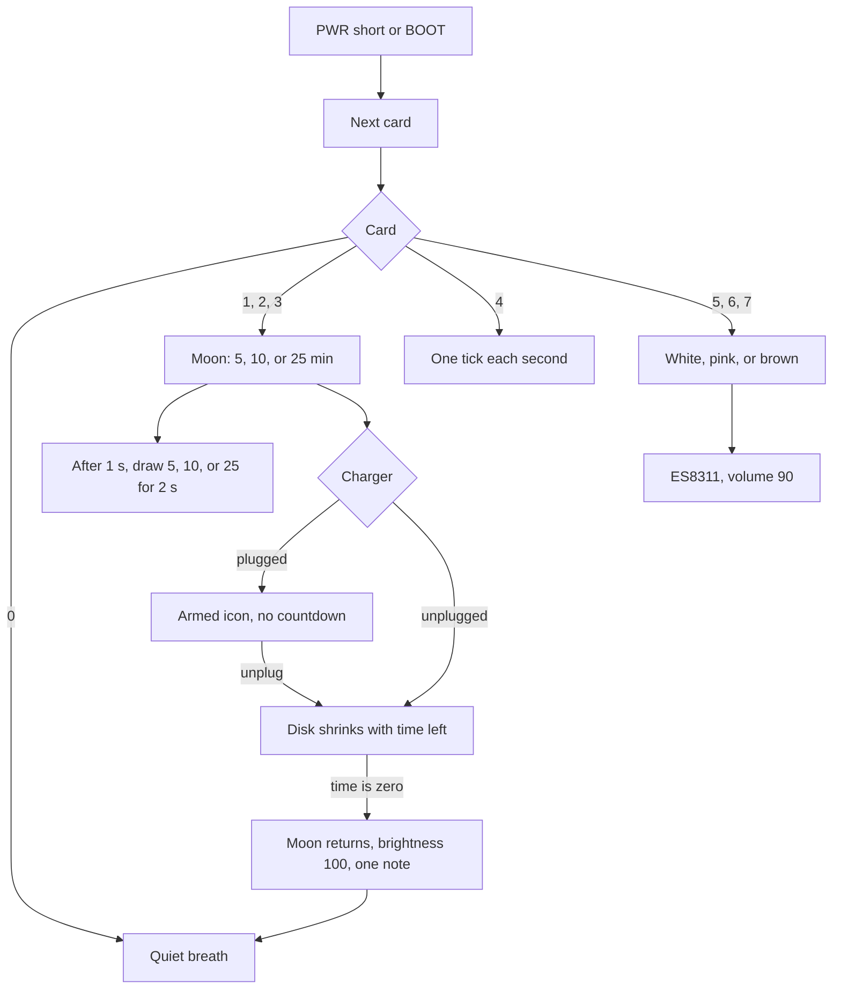
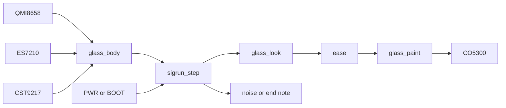

# Sigrún

Pocket breath glass on a Waveshare ESP32-S3-Touch-AMOLED-1.75C. One 466×466 picture. No labels except a number that appears for a moment when a timed task is chosen.

## Hardware

| Part | Role |
| --- | --- |
| ESP32-S3R8 | 240 MHz, 8 MB PSRAM, 32 MB flash |
| CO5300 | 466×466 RGB565, circle mask r=232, brightness 35 |
| CST9217 | Touch |
| QMI8658 | Accel ±4 g, gyro ±256 dps, I2C 0x6B or 0x6A |
| ES7210 | Mics, 16 kHz stereo |
| ES8311 | Speaker, PA on GPIO46, codec volume 90 |
| AXP2101 | PMIC, I2C 0x34. Short press is a mode step. Long press is power-off |
| GPIO0 | BOOT. Short press is the same mode step |

I2C is GPIO14 SCL and GPIO15 SDA. The sense loop is 20 ms. A painted frame is about 60–80 ms.

## Behavior

A short press of PWR or BOOT advances one card, on the charger or off it:

`quiet → 5 min → 10 min → 25 min → tick → white → pink → brown → quiet`

The picture is the mode. A moon is a task. The tick is one click a second, and the mote flashes with it. A bright arc is white noise, a warmer arc is pink, a heavy warm ring is brown. Quiet is a plain breath. Noise, the tick, and a task are exclusive. The speaker is silent in quiet.

On the charger a moon is armed and does not count. Off the charger it starts on that press, or when unplugged. The lit fraction is time left over the chosen length, scaled by 0.34, 0.66, or 1. One second after the press the digits 5, 10, or 25 are drawn for about 2 s, then fade in 0.4 s.

At zero the moon opens again and the panel rises from 35 to 100 over about half a second. The end note swells over the same half second, then decays. Brightness falls back to 35 and the card returns to quiet.

An hour with no touch on the glass fades the panel from its current brightness down to 0 over 0.9 s and stops painting. The touch reader keeps running. A touch brings the panel back up to its normal brightness over the same 0.9 s and painting resumes.

Breath source, first match: a finger trace while unplugged and not holding the bead (period at least 7.5 s), else walking at 5.6 s, else sway at 10 s, else a close breath in a quiet room, else a 10 s clock. A finger held at the bottom of the exhale waits there. Rest radius is 118 px, full is 206 px. Past radius 168 the stroke thickens, and it is about twice as wide at 206.

Tilt moves the picture, dead zone 0.02 g, full travel ±42 px by about 0.17 g. The bead can be flicked, bounces inside r=202, waits 1 s, then springs home. Color is teal. Warmth, from room level or the pink and brown cards, shifts it toward gold.

## Logic





`glass_body` turns the IMU into walk, sway, still, fidget, and rock, the touch into a breath period or a bead grab, and the mics into room level and a close breath. `sigrun_step` picks the breath and the card. `glass_paint` draws the ring as one band, the moon, the bead, and the digits into a heat buffer, then dithers that to RGB565.

## Build

Host checks, no board:

```bash
make -C preview test
```

Firmware, ESP-IDF 5.5:

```bash
cd firmware
idf.py set-target esp32s3
idf.py build flash monitor
```

Stills from the host painter are in `docs/proof/`.

## Battery

The included cell is a 702530 lithium polymer, 3.7 V, 500 mAh, 1.85 Wh (SKU 33691). Nothing below was measured on this unit. Wi-Fi and Bluetooth are not started. The CPU stays at 240 MHz. After the screen sleeps, painting stops and the panel is at brightness 0, but the chip, the microphones, and the motion sensor stay awake. A long press of PWR is what actually turns the board off.

| Use | Estimate from a full charge |
| --- | --- |
| Screen on, quiet breath | 4–6 h |
| Screen on, tick | 4–5 h |
| Screen on, noise | 3–4.5 h |
| Left on, screen asleep after an hour | 8–14 h |
| A normal day, powered off between sessions | 4–6 days |

A normal day here is about an hour of holding it: a 10 minute quiet breath, one 25 minute timer, and 10 minutes of tick or noise, then a long press of PWR until the next time. That is on the order of 80–120 mAh. Left running on a desk or in a pocket, the dark screen still costs most of the cell, and it is empty in about a day.

## Sources

The numbers in the breath and the timers come from these, and only to the extent named.

- The resting breath is 6 a minute (10 s), with the inhale at 4.5 s and the exhale at 5.5 s. A finger cannot drive it faster than 8 a minute (7.5 s). Slow breathing in the research is under 10 a minute. Zaccaro A, Piarulli A, Laurino M, Garbella E, Menicucci D, Neri B, Gemignani A. How breath-control can change your life: a systematic review on psycho-physiological correlates of slow breathing. Front Hum Neurosci. 2018;12:353. https://doi.org/10.3389/fnhum.2018.00353
- A rate near 6 a minute is the usual resonance target. Lehrer PM, Vaschillo E, Vaschillo B. Resonant frequency biofeedback training to increase cardiac variability: rationale and manual for training. Appl Psychophysiol Biofeedback. 2000;25(3):177–191.
- The longer exhale, and the sigh routine still compiled in `glass_look_sigh` but not started by a button, follow the exhale-weighted cyclic sigh. Balban MY, Neri E, Kogon MM, et al. Brief structured respiration practices enhance mood and reduce physiological arousal. Cell Rep Med. 2023;4(1):100895. https://doi.org/10.1016/j.xcrm.2022.100895
- The 25 minute moon is a Pomodoro focus block. The 5 and 10 minute moons are shorter blocks of the same kind, not a separate finding. Cirillo F. The Pomodoro Technique.
- White, pink, and brown are continuous masks, one equal-energy spectrum each. They are not the phase-locked pink-noise pulses used in sleep studies. Papalambros NA, Santostasi G, Malkani RG, et al. Acoustic enhancement of sleep slow oscillations and concomitant memory improvement in older adults. Front Hum Neurosci. 2017;11:109. https://doi.org/10.3389/fnhum.2017.00109

Walking changes the period to 5.6 s so the ring can follow a gait. That is a device rule, not a cited protocol. The bead is a fidget, not a clinical claim.
