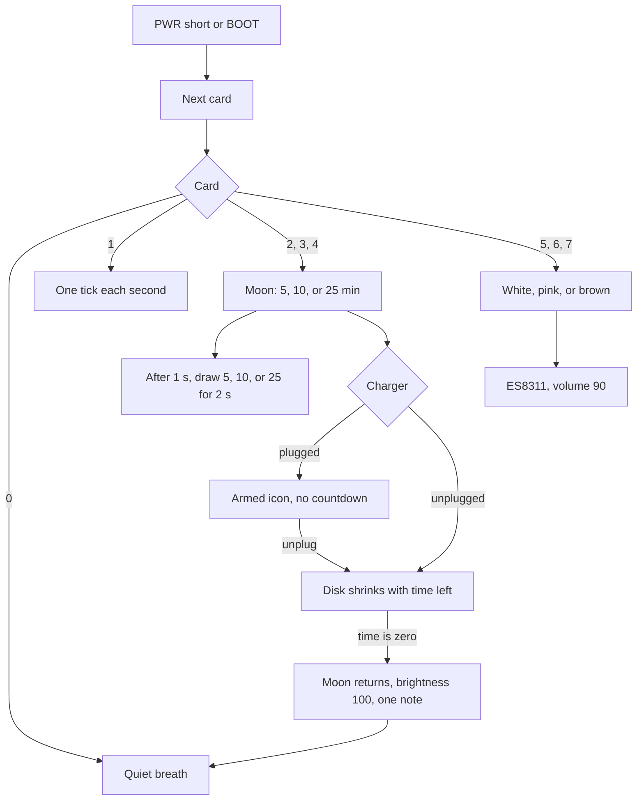
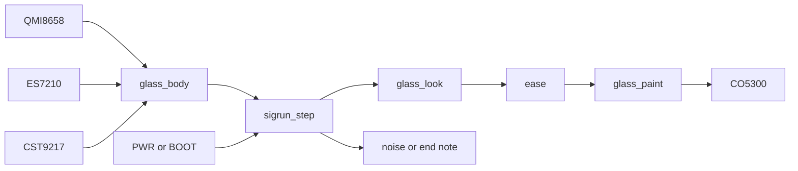

# Sigrún

Pocket breath glass on a Waveshare ESP32-S3-Touch-AMOLED-1.75C. One 466×466 picture. No labels except a number that appears for a moment when a timed task is chosen.

## Hardware

| Part | Role |
| --- | --- |
| ESP32-S3R8 | 240 MHz, 8 MB PSRAM, 32 MB flash |
| CO5300 | 466×466 RGB565, circle mask r=232, brightness 35 |
| CST9217 | Touch |
| QMI8658 | Accel ±4 g, gyro ±256 dps, I2C 0x6B or 0x6A |
| ES7210 | Mics, 16 kHz stereo |
| ES8311 | Speaker, PA on GPIO46, codec volume 90 |
| AXP2101 | PMIC, I2C 0x34. Short press is a mode step. Long press is power-off |
| GPIO0 | BOOT. Short press is the same mode step |

I2C is GPIO14 SCL and GPIO15 SDA. The sense loop is 20 ms. A painted frame is about 60–80 ms.

## Behavior

A short press of PWR or BOOT advances one card, on the charger or off it:

`quiet → tick → 5 min → 10 min → 25 min → white → pink → brown → quiet`

The picture is the mode. A tick is one click a second, and the mote flashes with it. A moon is a task. A bright arc is white noise, a warmer arc is pink, a heavy warm ring is brown. Quiet is a plain breath. Noise, the tick, and a task are exclusive. The speaker is silent in quiet.

On the charger a moon is armed and does not count. Off the charger it starts on that press, or when unplugged. The lit fraction is time left over the chosen length, scaled by 0.34, 0.66, or 1. One second after the press the digits 5, 10, or 25 are drawn for about 2 s, then fade in 0.4 s.

At zero the moon opens again, panel brightness rises from 35 to 100, and one decaying note plays, with a short low pulse in the hand. Brightness falls back to 35 and the card returns to quiet.

Breath source, first match: a finger trace while unplugged and not holding the bead (period at least 7.5 s), else walking at 5.6 s, else sway at 10 s, else a close breath in a quiet room, else a 10 s clock. A finger held at the bottom of the exhale waits there. Rest radius is 118 px, full is 206 px. Past radius 168 the stroke thickens, and it is about twice as wide at 206.

Tilt moves the picture, dead zone 0.02 g, full travel ±42 px by about 0.17 g. The bead can be flicked, bounces inside r=202, waits 1 s, then springs home. Color is teal. Warmth, from room level or the pink and brown cards, shifts it toward gold.

## Logic





`glass_body` turns the IMU into walk, sway, still, fidget, and rock, the touch into a breath period or a bead grab, and the mics into room level and a close breath. `sigrun_step` picks the breath and the card. `glass_paint` draws the ring as one band, the moon, the bead, and the digits into a heat buffer, then dithers that to RGB565.

## Build

Host checks, no board:

```bash
make -C preview test
```

Firmware, ESP-IDF 5.5:

```bash
cd firmware
idf.py set-target esp32s3
idf.py build flash monitor
```

Stills from the host painter are in `docs/proof/`.
